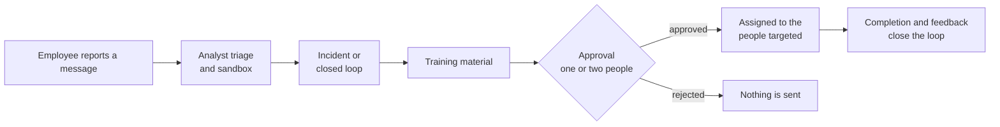
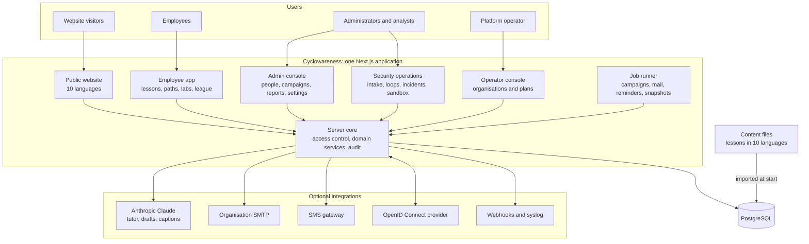

# Cyclowareness

Cyclowareness is a security awareness platform for organisations. It combines short interactive training, phishing simulations and the security operations work that connects them, in one web application. It runs in ten languages, either as a hosted multi-tenant service or on a customer's own servers.

Cyclowareness is developed by Safarov Industries. The product is in pre-release: it runs end to end locally and in Docker, and has not had its first customer release.

- [The problem](#the-problem)
- [The solution](#the-solution)
- [What is different](#what-is-different)
- [Key features](#key-features)
- [Architecture](#architecture)
- [Tech stack](#tech-stack)
- [Quick start](#quick-start)
- [Project status](#project-status)
- [Roadmap](#roadmap)
- [Repository layout](#repository-layout)
- [Documentation](#documentation)

## The problem

Phishing, payment fraud and account takeover usually reach an organisation through its people. The attack arrives as an email, a text message, a phone call, a QR code, a USB drive or a fake sign-in page. Technical controls stop part of it, and an employee's decision handles the rest.

Most awareness programmes leave four gaps:

- **Training is a yearly event.** A long course, a quiz and a certificate satisfy an auditor, but they do not build a habit and rarely show whether behaviour changed.
- **Simulations punish instead of teach.** A click often leads to a warning page or a report to a manager. Security gateways that open links automatically also create false clicks.
- **Tools are disconnected.** Training, simulations, reported threats and incidents live in separate systems. When an employee reports a real phishing email, nothing turns that report into training for the colleagues the same attacker targeted.
- **Risk is a number without a reason.** Managers see a score but not why it is what it is, or what would lower it.

Organisations that work in several languages, or that must keep data on their own infrastructure, also need the same product in every language and on their own servers.

## The solution

Cyclowareness gives each group in the organisation one place to work.

- **Employees** take three-minute lessons built as interactive scenes. They practise on simulated inboxes, phones, browsers and calls, and can ask an AI tutor about the lesson they are in.
- **Simulation recipients** who click a test link see at once, in their own language, the signs they missed and the lesson that covers them.
- **Security analysts** receive reports from employees, analyse links and files in a static sandbox, open incidents, and route real threats into approved training for the people who were targeted.
- **Administrators and leaders** see completion, simulation results and a per-person risk score broken into its parts. They export the evidence auditors ask for.

## What is different

Each point below describes code that exists in this repository.

1. **Real threats become training.** A threat reported by an employee, or an intelligence item, can start a *closed loop*: intake, analysis, conversion, approval, targeting, training, feedback. Material produced along the way needs human approval, optionally from two people, before it reaches anyone.
2. **Simulations count only people.** Clicks from mail security scanners and link prefetchers are not recorded. The fake sign-in form never sends what was typed; only the fact of submission is stored.
3. **Risk is explained.** Every score from 0 to 100 is the sum of five visible parts: training, overdue work, simulations, open risks and knowledge. The administrator's person page and the employee's own security page show each part.
4. **The AI tutor knows the lesson, not the learner.** Only the lesson's text and the question go to the model. Without an API key the tutor still answers, from the lesson text.
5. **One product in ten languages.** Azerbaijani, English, Russian, Turkish, Romanian, Georgian, Ukrainian, German, French and Arabic, written right to left, cover the interface, every lesson, emails, certificates and policies. Each email goes out in the recipient's own language.
6. **The customer chooses where data lives.** The same image runs as a multi-tenant service or on the customer's servers with Docker Compose. The sandbox keeps only file hashes and findings, never the files.



## Key features

### For employees

- **Library.** 53 modules with 106 lessons in nine categories: email, accounts, social engineering, devices, AI threats, physical security, data, workplace and incidents. Almost every lesson takes three minutes.
- **Lessons.** Eleven scene types, including simulated inbox, phone, browser, desktop and call environments, spot-the-signs hotspots, safe-or-trap card swipes and branching scenarios.
- **Lesson player.**
  - Narration with word-by-word highlighting.
  - Captions in the ten languages, plus AI-translated captions in 65 more.
  - A transcript, keyboard shortcuts and a full, calm or still motion setting.
- **AI tutor.** AI Sel, the mascot, answers questions about the current lesson, by text or by voice.
- **Learning paths and labs.** Five learning paths and seven practice labs. Paths show each lab after the lessons it practises, and the lab area stays open for free practice.
- **Motivation and proof.** XP, levels, daily streaks with streak freezes, a department league, and certificates with a public verification page.
- **Reporting and checks.** A button to report suspicious messages, a personal risk view, and a sandbox check for links and files.
- **Everything else.** Policies to read and sign, support tickets, live sessions, and a "download my data" export.
- **App.** Installs as a progressive web app.

### For administrators

- **People.** People and departments in a hierarchy, CSV import, invitation links and roles.
- **Assignments.** Due dates, automatic reminders, manager alerts, and monthly refreshers for people at or above the risk threshold.
- **Phishing simulations.** Twelve templates for email, SMS, QR code, USB drop and voice call; voice-call campaigns refuse to launch until a telephony adapter exists. Scheduling, an open, click, submit and report funnel, and a teachable moment after each click.
- **Policies.** Versions and translations, with a sign-off export for auditors.
- **Studio.** Content creators draft new courses with AI, or from the closest library module when no AI key is set. They review each draft and publish it themselves.
- **Reports.** Eight report types as CSV or XLSX, scheduled report emails, and printable reports and a compliance pack.
- **Settings.**
  - Branding, languages, email delivery and notification templates.
  - Attestation and certificate wording.
  - Learning rules, content protection and email-domain proof.
  - Single sign-on through OpenID Connect.
  - Webhooks and syslog.
- **Control.** An audit log of sign-ins and administrative changes, and two-step verification required for console roles by default.

### For security teams

- Threat intake from employee reports, with triage and conversion.
- Closed loops and an approval stage for training material.
- Incidents with indicators, MITRE ATT&CK techniques, a confidential flag, and automatic training of the people involved.
- A static sandbox for URLs and files up to 10 MB, with STIX 2.1 export.
- Triage of threat and policy intelligence items, an operations centre and a support desk.
- Signed webhooks and syslog in CEF or JSON for the SIEM.

### For leadership and the platform operator

- A leadership board with completion, reporting rate, policy coverage, the risk trend, incidents, closed loops and a department breakdown.
- An operator console to create organisations, assign plans, switch single features on or off, record domain proofs and review demo requests.
- Three plans, Essentials, Professional and Enterprise HRM, each adding features to the one before. The full list is in [ARCHITECTURE.md](docs/ARCHITECTURE.md#4-tenancy-and-access-control).

## Architecture

Cyclowareness is one Next.js application with one PostgreSQL database. Pages are rendered on the server. Writes go through server actions that check the person's role and plan, and every query is limited to the person's organisation. Background work runs in the same process, or in an optional worker. There is no message queue or cache server to operate.



The full description, with the request lifecycle, data model, background jobs and security controls, is in [docs/ARCHITECTURE.md](docs/ARCHITECTURE.md). The HTTP endpoints and integration contracts are in [docs/API.md](docs/API.md).

## Tech stack

| Layer | Technology |
|---|---|
| Application | Next.js 16 (App Router, React Server Components, Server Actions), React 19, TypeScript in strict mode |
| Interface | Tailwind CSS 4, Lucide icons, a Canvas 2D mascot (the Rive runtime is kept as an alternative) |
| Languages | next-intl with ten locales, right-to-left support for Arabic |
| Data | PostgreSQL (the Docker stack ships version 16), Drizzle ORM, node-postgres; embedded PGlite for local development |
| Validation | Zod |
| Authentication | Own implementation: Argon2id passwords, database sessions, TOTP (Oslo), OpenID Connect with PKCE |
| AI | Anthropic Claude through the official SDK; models are configuration settings |
| Email and SMS | Nodemailer over each organisation's SMTP server; a generic HTTPS webhook for SMS |
| Narration | Browser speech synthesis, with optional pre-generated ElevenLabs clips |
| Testing and quality | Vitest, ESLint, TypeScript type checking, a lesson translation checker |
| Delivery | Docker multi-stage image on Node.js 24, Docker Compose with PostgreSQL 16 |

## Quick start

### Three-minute demo

One command builds a fresh demo organisation in the embedded database and starts the portal:

```bash
npm --prefix portal run demo
```

Then open http://localhost:3000/sign-in?next=/admin/drill and follow [docs/DEMO.md](docs/DEMO.md), which has the talk track for the live drill. With Docker instead: `docker compose -f portal/docker-compose.demo.yml up --build`.

### Local development

You need Node.js 24 (the version of the Docker image and CI) and npm. You do not need a database server: an embedded PostgreSQL stores data in `portal/.data/pg`.

```bash
cd portal
```

```bash
npm install
```

```bash
cp .env.example .env.local
```

```bash
npm run setup
```

```bash
npm run dev
```

`npm run setup` applies the migration and loads a fictional demo organisation, Safarov Industries, with about 35 people and a month of activity history. Open http://localhost:3000 and sign in with one of these accounts. The password for all of them is the `SEED_PASSWORD` value in `portal/.env.example`.

| Email | Role |
|---|---|
| `admin@safarovindustries.com` | Organisation administrator |
| `analyst@safarovindustries.com` | Security analyst |
| `campaigns@safarovindustries.com` | Campaign manager |
| `content@safarovindustries.com` | Content creator |
| `head@safarovindustries.com` | Department head |
| `leader@safarovindustries.com` | Executive |
| `learner@safarovindustries.com` | Employee |
| `operator@cyclowareness.com` | Platform operator |

The embedded database accepts one process at a time. Stop the dev server before running any `npm run db:*` script or `npm run content:sync`.

### Production-style stack with Docker

You need Docker Compose 2.24 or newer.

```bash
cd portal
```

```bash
cp .env.example .env
```

Edit `.env` and set these values:

- `APP_SECRET`: 32 or more random characters.
- `APP_URL`: the public `https://` address.
- `POSTGRES_PASSWORD`.
- `BOOTSTRAP_OPERATOR_EMAIL`: the first platform operator.

```bash
docker compose up -d --build
```

```bash
docker compose logs app | grep bootstrap
```

The last command prints the operator's one-time invitation link. The app listens on `127.0.0.1:3000`, ready for a TLS reverse proxy on the same host. Reverse proxies, scaling, the background worker and every environment variable are covered in [portal/README.md](portal/README.md).

### Checks

Run these from the repository root.

```bash
npm --prefix portal run typecheck
```

```bash
cd portal && npx eslint src tests scripts --max-warnings=0
```

```bash
cd portal && npx vitest run
```

```bash
cd portal && npx tsx scripts/check-lesson-locales.ts --coverage
```

## Project status

**Verified on this commit.** A clean install passes the type check, lint, the full test suite and the lesson translation check. The demo organisation loads with all lessons in all ten languages.

**Not yet verified:**

- live accounts with an email provider, an SMS gateway, the Anthropic API and an identity provider;
- natural-voice narration, because no clips have been generated;
- an image build on the release machine;
- a native-speaker review of seven of the ten languages, and a legal review of the privacy policy and terms. According to [docs/build/DECISIONS.md](docs/build/DECISIONS.md), these texts were translated and edited by AI agents.

**Release history.** The product has not had its first release. The database schema has been versioned since 2026-11-05: `portal/drizzle/0000_init.sql` is frozen and every schema change is a new, additive migration (ADR-034).

## Roadmap

The items below are open at this commit. They come from the code and from [docs/build/OPEN-QUESTIONS.md](docs/build/OPEN-QUESTIONS.md). No dates are committed.

### Before the first customer release

- Native-speaker review of Turkish, Romanian, Georgian, Ukrainian, German, French and Arabic.
- Legal review of the privacy policy and terms in all ten languages. The texts must also:
  - add the provider's company details;
  - name the AI services actually used. They currently name Google Vertex AI, while the code uses the Anthropic API.
- Choose a narration voice for each language and generate the ElevenLabs clips.
- Connect and test real providers: Anthropic, SMTP, an SMS gateway and an OpenID Connect identity provider.
- A server-side check that a learner went through a lesson before it counts as complete, so certificates can serve as compliance evidence.

### Product work not built yet

- SAML sign-in and LDAP directory synchronisation. Their settings screens exist.
- Binding single sign-on accounts to the identity provider's subject identifier, not only the email address.
- A telephony adapter that places voice-call simulations.
- Ingestion of threat and policy intelligence feeds.
- Server-generated PDF reports, attached to scheduled report emails.
- A time zone per organisation; all organisations use Baku time today.
- Dedicated sending domains for simulations, with their own SPF and DKIM.
- A separate upload route for the sandbox, so the general request size limit can shrink.
- The `risk.threshold_crossed` webhook event, which the settings already list.

### Under consideration

- SCORM or xAPI export for learning management systems.
- Editing the public website's content from the operator console.
- A native Android app; the progressive web app exists today.

## Repository layout

| Path | Contents |
|---|---|
| `portal/` | The application: source, content library, translations, migrations, tests, Dockerfile |
| `docs/ARCHITECTURE.md` | How the system is built |
| `docs/API.md` | HTTP endpoints and integration contracts |
| `docs/build/` | Build plan, progress, architecture decision records and open questions, in Azerbaijani |
| `docs/audit/` | Specification of the earlier product this one was rebuilt from; kept unchanged |
| `docs/business/` | Pricing material |
| `design/` | Mascot design sources |
| `.claude/skills/` | Working reference for lessons, translations, narration and the mascot |

## Documentation

| Document | For |
|---|---|
| [docs/ARCHITECTURE.md](docs/ARCHITECTURE.md) | Engineers and technical evaluators |
| [docs/API.md](docs/API.md) | Integrators: SIEM, SOAR, identity provider, SMS gateway |
| [portal/README.md](portal/README.md) | Operators: environment variables, Docker, proxies, jobs, languages, narration |
| [docs/build/DECISIONS.md](docs/build/DECISIONS.md) | Architecture decision records |
| [docs/build/OPEN-QUESTIONS.md](docs/build/OPEN-QUESTIONS.md) | Decisions and accounts the owner still has to provide |

## Licence

The code and content are proprietary: [LICENSE](LICENSE) reserves all rights and grants no licence to use, copy or modify them. Contact Safarov Industries before any use. Contributions follow [CONTRIBUTING.md](CONTRIBUTING.md), and vulnerabilities are reported as described in [SECURITY.md](SECURITY.md).
