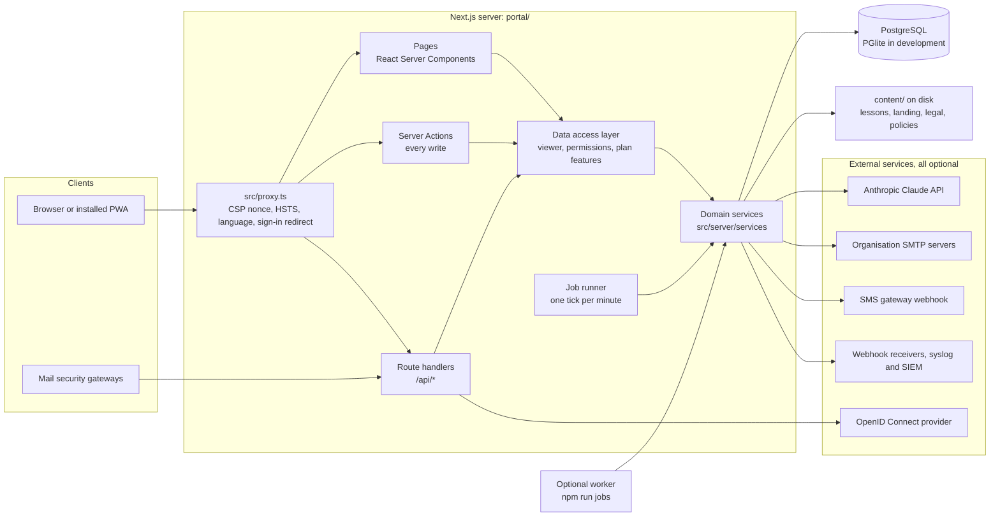
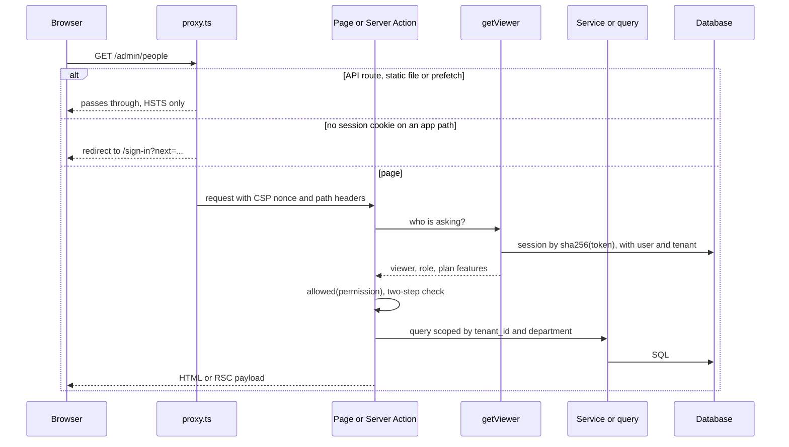
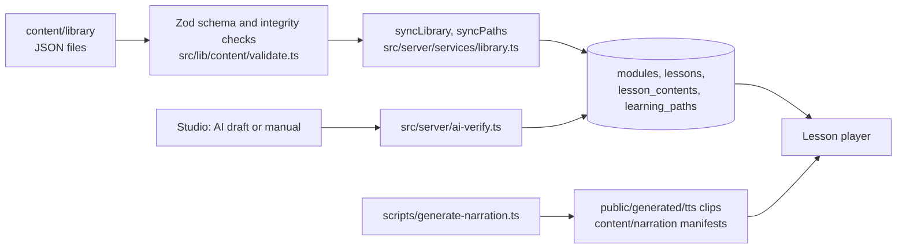
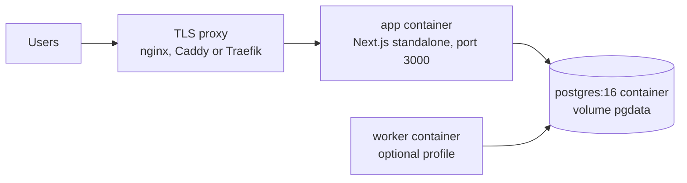

# Architecture

This document describes how Cyclowareness is built. It covers the code in `portal/` at the commit it ships with, and it names the file behind each statement so a reader can check it.

- Operations detail, such as every environment variable, Docker and reverse proxies, is in [`portal/README.md`](../portal/README.md).
- The HTTP interface and the outbound integrations are in [API.md](API.md).
- Decisions and their reasons are in [`docs/build/DECISIONS.md`](build/DECISIONS.md), written in Azerbaijani.

## Contents

1. [System overview](#1-system-overview)
2. [Code layout](#2-code-layout)
3. [Request lifecycle](#3-request-lifecycle)
4. [Tenancy and access control](#4-tenancy-and-access-control)
5. [Authentication](#5-authentication)
6. [Data model](#6-data-model)
7. [Content pipeline](#7-content-pipeline)
8. [Learning, progress and risk](#8-learning-progress-and-risk)
9. [Phishing simulations](#9-phishing-simulations)
10. [Security operations](#10-security-operations)
11. [AI features](#11-ai-features)
12. [Background jobs](#12-background-jobs)
13. [Outbound connections](#13-outbound-connections)
14. [Languages](#14-languages)
15. [Security controls](#15-security-controls)
16. [Deployment](#16-deployment)
17. [Known limitations](#17-known-limitations)

## 1. System overview

Cyclowareness is one Next.js application with one PostgreSQL database. The same codebase serves five surfaces:

- the public website,
- the employee app,
- the administration console,
- the security operations views,
- the platform operator console.

Background work runs inside the web process, or in an optional worker process built from the same code. There is no message queue, no cache server and no separate API service.

Each external service is optional. Without one, the related feature falls back to a safe local behaviour or reports itself as unavailable (`src/server/env.ts`).

| Service | Without it |
|---|---|
| Anthropic API key | The tutor answers from the lesson text, the studio builds drafts from the closest library module instead of AI, AI subtitles report that none are available |
| Organisation SMTP | Mail is kept in the outbox with status `logged`, visible to administrators |
| SMS provider | Development logs the message; production reports SMS as unavailable |
| Identity provider | People sign in with a password, or with a phone code if they are learners |
| Webhook or syslog target | No events leave the platform |

## 2. Code layout

| Path | Contents |
|---|---|
| `src/app/` | App Router routes. Route groups share layouts, not URL segments: `(site)` public site, `(auth)` sign-in and account links, `(learner)` employee app, `(focus)` full-screen lesson player and policy reader, `(admin)` console and operator console, `(public)` token pages, `(print)` printable reports, `api/` route handlers |
| `src/proxy.ts` | Runs before every request: security headers, language of the public site, optimistic sign-in redirect |
| `src/instrumentation.ts` | Server start: validates the environment, imports content, starts the job runner |
| `src/server/auth/` | Sessions, passwords, TOTP, account links, OIDC, permissions, the viewer |
| `src/server/actions/` | Server Actions, which carry the interface's writes |
| `src/server/queries/` | Read models used by pages |
| `src/server/services/` | Domain logic shared by actions, jobs and the seed |
| `src/server/db/` | Drizzle schema and the two database drivers |
| `src/server/sandbox/`, `reports/`, `lab/` | Static file and URL analysis, CSV and XLSX export, lab scoring |
| `src/server/jobs.ts`, `jobs-runner.ts` | Background steps and the runner |
| `src/lib/` | Pure shared code: domain rules, content schema, campaign templates, formatting |
| `src/components/` | Interface components by area |
| `src/i18n/` | Language list, resolution and message loading |
| `content/` | Lessons, learning paths, landing copy, legal texts, policies; read from disk at run time |
| `messages/` | Interface strings, ten languages, nine namespaces each |
| `drizzle/` | SQL migrations |
| `scripts/` | Migrate, seed, content sync, worker, narration generator, checks |
| `tests/` | Vitest suites |

## 3. Request lifecycle

- **The proxy check is optimistic.** It looks only for the session cookie (`src/lib/app-paths.ts`). The real check happens in the data access layer, `src/server/auth/viewer.ts`, which every page, action and route handler calls.
- **Reads** happen in server components through `src/server/queries/`. Only the data a page needs reaches the browser.
- **Writes** go through Server Actions. An action for a signed-in person starts with `actionViewer(permission)`, which throws when the person is signed out, lacks the permission or still has to set up two-step verification. Administrative changes are written to the audit log (`src/server/services/audit.ts`), and the page refreshes.
- **Writes outside that path.** The sign-in and demo-request actions run before anyone is signed in and apply their own rate limits. The invitation-link download is a route handler. The tracking pages `/t` and `/q` record clicks.
- **Route handlers** under `/api` serve downloads, the tutor stream and integrations. Their access rules are in [API.md](API.md).

## 4. Tenancy and access control

**Tenants.** An organisation is a row in `tenants`. It holds the plan, branding, a `settings` JSON document, per-tenant feature overrides and the proven email domain. Organisation data carries a `tenant_id` column with a cascading foreign key, either on the row itself or on its parent row. A campaign recipient, for example, belongs to its campaign, and lesson progress to its user. Library modules and learning paths have `tenant_id` null and are shared by every tenant; modules and paths made in the console belong to one tenant. Platform mail in the outbox has no tenant.

**Roles.** There are eight roles (`src/server/db/schema.ts`).

| Role | Purpose |
|---|---|
| `learner` | Employee: lessons, paths, league, labs, reports, support |
| `department_head` | Sees people, assignments and reports for their departments and sub-departments |
| `executive` | Leadership view and reports |
| `analyst` | Security operations: threats, sandbox, incidents, loops, approvals, audit log |
| `campaign_manager` | Phishing simulations |
| `content_creator` | Assignments, policies, studio, learning paths, live sessions, feedback |
| `tenant_admin` | Everything in the organisation, including settings |
| `super_admin` | Platform operator: organisations, plans, demo requests |

**Permissions.** `src/server/auth/permissions.ts` maps 27 permissions to roles. Some permissions also need a plan feature, through `PERMISSION_FEATURE`. Both are checked on the server, in pages, actions and route handlers.

**Plans.** `PLAN_FEATURES` in `src/lib/tenant-defaults.ts` defines three cumulative plans. An operator can switch single features on or off for one tenant.

| Plan | Features added |
|---|---|
| `essentials` | learning, league, certificates, policies, campaigns, reports, lab, paths, support, feedback, live_sessions |
| `professional` | ai_tutor, tutor_voice, sms_voice, qr_trap, sandbox, threat_intake, incidents, risk_profiles, sso, ldap, integrations, compliance_pack, studio |
| `enterprise_hrm` | closed_loops, approvals, threat_intel, policy_intel, leadership, ops_center |

**Department scope.** A department head sees only their departments and the departments below them. The scope is computed in `scopeDepartmentIds` (`src/server/queries/admin.ts`) and applied by the queries and the report builder.

**Two-step verification rules.**

- The platform operator always needs it.
- Every console role needs it when the organisation's "require two-step verification" rule is on. New organisations have it on.
- `tenant_admin`, `super_admin`, `analyst` and `campaign_manager` always sign in with a password, never with SSO or a phone code. Their second step follows the two rules above.
- No console role can sign in with a text-message code.

## 5. Authentication

The authentication layer is the project's own code; it does not use an auth library (ADR-005).

| Part | Implementation |
|---|---|
| Sign-in flow | Email first. `src/server/auth/sso-routing.ts` then chooses the password step or the organisation's identity provider |
| Passwords | Argon2id through `@node-rs/argon2` (19 MiB memory, 2 iterations, 1 lane) with a strength check from `@zxcvbn-ts` |
| Sessions | A random 24-byte token in an HttpOnly, SameSite=Lax cookie (`__Host-cy_session`, Secure in production). The database stores only its SHA-256. The expiry slides to 30 days on use, with an absolute limit of 90 days after sign-in |
| Device limit | An optional per-organisation maximum; the oldest sessions are removed |
| Two-step verification | TOTP through `@oslojs/otp`, with hashed one-time backup codes |
| Phone sign-in | One-time SMS codes for learners, with counted attempts |
| Lockout | Failed attempts per account and client address within 15 minutes (`login_attempts`) |
| Account links | Invitation and password-reset tokens, stored as hashes; invitations last 14 days |
| Single sign-on | OpenID Connect authorization code flow with PKCE (S256), state and nonce (`src/server/auth/oidc.ts`) |
| Domain proof | A DNS TXT record `cyclowareness-verify=…`, re-checked daily, with a 7-day grace period when it disappears |

Single sign-on details:

- Provider endpoints must use HTTPS and, in production, resolve to public addresses.
- Discovery documents are cached for five minutes, so an anonymous visit does not always reach the provider.
- The standard `email` claim counts only when `email_verified` is `true`.
- New learners are created on first sign-in only when the organisation allows it and the address is on the organisation's saved domain. The sign-in page offers SSO only while the domain proof is valid, but the callback compares the address with the saved domain without re-checking the proof.
- Accounts are matched by email address.

SAML and LDAP settings can be saved, with their secrets encrypted, but no SAML exchange and no directory synchronisation are implemented.

## 6. Data model

The schema is `src/server/db/schema.ts`: 51 tables, created by one migration, `drizzle/0000_init.sql`. Until the first release that migration is regenerated instead of adding new ones.

| Area | Tables |
|---|---|
| Tenancy and identity | `tenants`, `departments`, `users`, `sessions`, `auth_tokens`, `login_attempts`, `rate_limit_buckets`, `audit_log`, `notifications`, `watermark_codes` |
| Content library | `modules`, `lessons`, `lesson_contents`, `learning_paths` |
| Learning | `assignments`, `module_progress`, `lesson_progress`, `answers`, `xp_events`, `attestations`, `certificates`, `policies`, `policy_versions`, `policy_signoffs`, `live_sessions`, `session_registrations`, `lab_attempts` |
| Risk and security operations | `behavior_risks`, `risk_snapshots`, `user_risk_snapshots`, `threat_reports`, `sandbox_analyses`, `incidents`, `loops`, `loop_events`, `materials`, `material_decisions`, `intel_items` |
| Phishing simulations | `campaigns`, `campaign_recipients` |
| Support and feedback | `problem_reports`, `support_tickets`, `ticket_messages`, `feedback` |
| Platform operator | `demo_requests` |
| Delivery and background work | `outbox`, `report_schedules`, `webhook_deliveries`, `tutor_cache`, `ai_cache`, `assets` |

Conventions:

- **Keys and time.** Most tables have random UUID primary keys. Sessions, account tokens and the AI caches are keyed by a hash, watermark codes by the code itself, and progress, translation and rate-limit tables by composite keys. Every timestamp is `timestamptz`.
- **Localised text.** Text shown in several languages is stored as a JSON map of locale to text, such as module titles and certificate wording.
- **Numbered records.** Threat reports, sandbox analyses, incidents and support tickets get a per-tenant number with a unique `(tenant_id, number)` index. A concurrent insert that loses the race retries with the next number (`insertNumbered` in `src/server/services/threats.ts`).
- **Settings.** Organisation settings live in `tenants.settings` as JSON (`TenantSettings`). Secrets inside it are encrypted with AES-256-GCM under a key derived from `APP_SECRET` (`src/server/crypto.ts`).
- **Drivers.** The same schema runs on node-postgres when `DATABASE_URL` is set, and on embedded PGlite in `.data/pg` otherwise (`src/server/db/client.ts`).

## 7. Content pipeline

The training library is versioned with the code, as files.

| File | Contents |
|---|---|
| `content/library/modules.json` | 53 modules in 9 categories, with lesson lists, minutes, XP and difficulty |
| `content/library/lessons/{module}/{lesson}.{locale}.json` | 106 lessons, each in 10 languages |
| `content/library/paths.json` | 5 learning paths, each with modules and labs |
| `content/library/i18n.{locale}.json` | Translated module and lesson titles |
| `content/library/brands.json` | Fictional brands used inside lesson scenes |

- **Lesson format.** A lesson is a list of scenes. The schema allows 11 scene types: `tutor`, `intro`, `simulation`, `choice`, `hotspot`, `swipe`, `match`, `order`, `scenario`, `password` and `recap`. Scenes show 12 kinds of artifact, such as an email, chat, SMS, login page, phone call, QR code or Wi-Fi prompt.
- **Translations.** A translation may change only learner-facing text. Ids, answers, addresses and links must match the English file (`src/lib/content/locale-parity.ts`). The check script verifies all 954 translations.
- **Import.** The production server imports the library on every start, in one transaction under a PostgreSQL advisory lock (`src/server/bootstrap.ts`). `npm run content:sync` does the same. Modules and lessons are matched by slug and key, so progress and assignments survive an import. Studio lessons are never touched. The demo seed is different: it empties every table first, then imports.
- **Language at run time.** `pickLessonContent` serves the learner's language, then English, then any stored language.
- **Read from disk at run time.** Landing copy and legal texts are read on each request. The brand list is read once per server process.
- **Narration.** `scripts/generate-narration.ts`, run by hand before building the image, creates one ElevenLabs clip per spoken string and language, with word timings. Manifests are served only to the signed-in learner of that lesson. Sentences without a clip are read by the browser's speech engine. The repository contains no clips yet.
- **Studio lessons.** A studio lesson, written by hand or drafted by AI, exists only in the database and starts as a draft.

## 8. Learning, progress and risk

**Assignments.** An assignment targets everyone, a department with its sub-departments, or one person. It points at a module or a learning path, with an optional due date. `resolveAssignments` (`src/server/services/assignments.ts`) computes who has to learn what. Reminder clocks start when the person actually became subject to the assignment: account activation, a department move, or the assignment's creation, whichever is latest.

**Completion.**

- A lesson attempt is the server's: `startLessonAction` records when it began, the player reports each scene it shows (`reachSceneAction`, furthest scene only) and sends what the learner picked in every scored scene. `completeLessonAction` scores those picks from the stored lesson content (`src/lib/content/scoring.ts`), computes correctness, first-try and outcome itself, and refuses an attempt that was not started here, took less than max(20 s, 25 % of the lesson's minutes), skipped a scene or left a scored scene unanswered (audit `learning.completion_refused`, one typed error the player shows). The attempt is used up by one conditional update before anything is written, so a duplicate completion stores nothing. Time trained is the server's clock, at most three times the lesson's nominal length; a start older than four hours is a new sitting (`startLesson` restarts the clock).
- A lesson awards its share of the module's XP the first time. Repeating it awards nothing but records the new completion time.
- When every lesson is done, the module waits for the learner's attestation. The attestation, the module's completion and its certificate (serial number, public verification page `/c/{token}`) are written in one transaction, backed by unique keys per person and module or path. Attestations and certificates carry `evidence`: `server_verified` for rows written since the check, `self_reported` for older rows; the certificate page, the compliance pack and the personal data export show it.
- Completing every module of a path issues a path certificate.

**Gamification** (`src/lib/domain/gamification.ts`).

- XP levels follow fixed thresholds.
- Daily streaks can be protected by streak freezes: one is earned every 7 consecutive days, at most 2 are held, and one covers a single missed day.
- The department league scores 60% assigned completion and 40% reporting of simulations from the last 90 days. It shows each department's trend against its place 7 days earlier (`src/server/services/league.ts`).

**Labs.** There are seven labs: four browser games and three simulated-desktop labs (`src/lib/domain/labs.ts`). In a learning path, a lab opens once the lessons it practises are done. The best attempt passes at 70% of its maximum. Labs are not part of certificates, and `/lab` stays open for free practice.

**Policies.** Policies have versions, each with optional translations. Sign-offs record the version, time and IP address. The sign-off list exports as CSV.

**Risk score.** `riskScore` in `src/lib/domain/risk.ts` gives every person a score from 0 to 100, lower is better, built from five visible parts.

| Part | Rule | Maximum |
|---|---|---|
| Training | Share of assigned lessons not completed × 30; 8 when nothing is assigned | 30 |
| Overdue | 5 per overdue assignment | 10 |
| Simulations, last 90 days | 12 per click, 18 per submitted fake sign-in, 2 per risky choice in a lesson simulation, minus 6 per reported simulation | 35 |
| Open risks | 4, 8, 14 or 20 per open risk, by severity | 30 |
| Knowledge, last 180 days | Share of answers not correct on the first try × 16; 8 below five answers | 16 |

The sum is capped between 0 and 100. Bands are low (0 to 33), medium (34 to 66) and high (67 to 100). The score is recomputed after each relevant event. The job runner stores a daily snapshot for each organisation and each person, which feeds the trend charts.

## 9. Phishing simulations

**Templates.** `src/lib/campaigns/templates.ts` holds 12 templates in all ten languages: 6 email, 3 SMS, 2 voice call and 1 USB drop. Each template carries:

- its sender,
- its red flags,
- the training module that follows a click,
- optionally a fake sign-in form, a QR code or a bait attachment name.

**Launch** (`src/server/services/campaigns.ts`).

1. The audience is everyone active, or one department with its sub-departments. The platform operator is never included.
2. A launch is refused with a reason when:
   - the audience is empty,
   - the channel has no provider in production,
   - the plan does not include the template.
3. Every recipient gets a random tracking token.
4. Delivery depends on the channel:
   - **Email** goes through the outbox and is sent by the job runner, with the template's display name and the organisation's own address.
   - **SMS** is sent by the job runner.
   - **USB** produces a CSV kit with one beacon file per drive.
   - **Voice** creates recipient rows only. No telephony adapter places calls yet.

**Tracking.**

- **Opens.** `/api/t/{token}/open` is a one-pixel image that records the first open.
- **Clicks.** `/t/{token}` and `/q/{token}` record the first click or QR scan. Each click opens a behaviour risk tied to the template's training module, recomputes the person's risk and emits an integration event.
- **Mail scanners.** Requests whose user agent or prefetch headers look like a mail security gateway are not counted (`src/server/tracking.ts`). Safe Links and sandbox detonations therefore do not create false clicks.
- **Teachable moment.** After a click the person sees the red flags in their own language, and a link to the lesson.
- **Fake sign-in.** The form's inputs have no names, so nothing typed leaves the browser. Only the fact of submission is stored.
- **Cancelled campaigns** record nothing more.

**Reporting.** An employee reports a suspicious message from the app, and every report is stored in `threat_reports`. When it matches a simulation sent to that person in the last 30 days, from a running or completed campaign, the recipient is marked as having reported it and the report is stored as triaged. Otherwise it enters threat intake as new. Every report earns a small XP bonus, up to a daily cap.

**Scheduling.** Scheduled campaigns launch from the job runner, on Baku time. A scheduled launch that cannot start goes back to draft once, with the reason and a notice to the campaign managers.

## 10. Security operations

| Function | What the code does |
|---|---|
| Threat intake | Employees report messages, calls, links, files or in-person attempts. Analysts triage, dismiss, sandbox the URL, or convert the report into a closed loop or an incident |
| Closed loops | A loop follows one threat through seven stages: intake, analysis, conversion, approval, targeting, training, feedback. Stages only move forward, and every move is logged in `loop_events` (`src/server/services/secops.ts`). Analysts start loops from a threat report or an intelligence item; a sandbox result reaches a loop by being escalated into a threat report. The schema also allows sandbox, incident and simulation sources, which only the demo seed uses |
| Approvals | Training material from AI, a template or an analyst waits for approval. A material can require a second approval. Only approved material reaches employees; approval moves its loop to the training stage, and a rejection sends nothing |
| Incidents | Severity, status, indicators of compromise, MITRE ATT&CK technique ids, a confidential flag, and an optional training module with target people, due date and pass score. Auto-training assigns that module to the targets |
| Sandbox | Static analysis of URLs and uploaded files up to 10 MB: URL heuristics, file type detection, ZIP and Office archive inspection, macros, entropy, indicator extraction and MITRE mapping. Nothing is executed or fetched, and file bytes are never stored, only the SHA-256 (`src/server/sandbox/analyze.ts`). Results export as STIX 2.1 |
| Intelligence | Threat and policy items can be triaged and converted into loops or policy updates. There is no feed connector: in the demo data the items come from the seed |
| Leadership | A board for executives: completion, reporting rate, policy coverage, risk trend, incidents opened and resolved, people trained through closed loops, and a department breakdown |
| Support desk | Tickets with categories, priorities and an SLA view; problem reports from lessons; lesson feedback |

## 11. AI features

All model calls use the Anthropic SDK (`@anthropic-ai/sdk`). The models are environment settings. Nothing that identifies a learner is sent.

| Feature | Model setting, default | Sent to the model | Stored | Without a key |
|---|---|---|---|---|
| Tutor in the lesson player (`/api/tutor`) | `ANTHROPIC_TUTOR_MODEL`, `claude-haiku-5-5` | The lesson's text (at most 9,000 characters), the current scene and the question (2 to 500 characters) | `tutor_cache`, by language, lesson, scene and normalised question; only complete answers | An answer assembled from the lesson text |
| Studio course drafts | `ANTHROPIC_MODEL`, `claude-opus-5-5` | The author's brief and parameters | A draft lesson, after schema checks, safety rules and an AI review pass (`src/server/ai-verify.ts`) | AI drafting is off. The studio can still assemble a draft from the closest library module, with the AI review step skipped |
| Subtitles in 65 more languages (`/api/subtitles`) | `ANTHROPIC_TUTOR_MODEL` | The lines the player speaks for that lesson | `ai_cache`, shared by every learner, keyed by a hash of the source text | The player reports that no subtitles are available |

- **Gating.** The tutor and AI subtitles need the `ai_tutor` plan feature. The studio needs `studio`.
- **Limits.** Per-person and per-organisation rate limits bound the cost (see [API.md](API.md#rate-limits)).
- **Human review.** AI subtitles are labelled as machine translated. AI drafts are saved as drafts, and they reach learners only when a person with studio rights publishes them.

## 12. Background jobs

`src/instrumentation.ts` starts the runner when the Node.js server starts, unless `JOBS_ENABLED=0`.

- **Timing.** The first tick runs after 15 seconds, then one every 60 seconds. A tick never overlaps the previous one.
- **One runner at a time.** With PostgreSQL, a session-level advisory lock on a dedicated connection lets only one process run a tick, across replicas and workers (`src/server/jobs-runner.ts`).
- **Isolation.** Every step is idempotent, and a failing step is logged without stopping the others.

The steps of one tick, in order (`runJobs` in `src/server/jobs.ts`):

1. **campaigns**: launch scheduled campaigns that are due, and mark running campaigns completed 14 days after launch.
2. **mail**: send queued mail.
3. **sms**: send queued SMS.
4. **events**: deliver webhooks and syslog messages.
5. **domains**: re-check proven domains once a day.
6. **cleanup**: apply the retention rules once a day.
7. For each organisation:
   - the daily risk snapshot,
   - assignment reminders,
   - manager alerts,
   - monthly refresher assignments for people at or above the organisation's risk threshold,
   - scheduled report emails.

Delivery rules:

- **Time budget.** Each delivery step stops after 20 seconds per tick.
- **Unreachable servers.** A server that cannot be reached is skipped for the rest of the tick, without using up the attempts of its other messages. One dead server cannot hold up other organisations.
- **Mail retries.** A message gets up to eight attempts, due 1, 2, 5, 15, 60, 240, 720 and 1,440 minutes after it was queued. Mail that is not deferred makes its first attempt at once. After the last attempt the message is marked failed and can be resent from Settings.
- **Event retries.** Webhook and syslog deliveries get up to six attempts, with growing delays.
- **Retention.** Once a day the runner deletes:
  - sign-in attempts older than two days,
  - expired sessions and links,
  - finished mail and event deliveries after 90 days,
  - watermark codes of ended sessions after 90 days,
  - read notifications after 400 days,
  - ended rate-limit windows.

`npm run jobs` runs the same loop as a separate worker, and `npm run jobs -- --once` runs one tick for cron. The worker needs PostgreSQL.

## 13. Outbound connections

Tenant administrators configure SMTP servers, webhook addresses, syslog servers and the OIDC issuer. In a multi-tenant deployment these must not let a customer probe the platform's own network. `src/server/net-guard.ts` enforces that:

- **Two checks.** A destination is resolved and checked when it is saved, and again right before every connection.
- **Refused addresses.**
  - IPv4: loopback, private, link-local, carrier-grade NAT, documentation, multicast and reserved ranges.
  - IPv6: unspecified, loopback, unique-local, link-local, site-local and multicast addresses, the local-use NAT64 prefix, and any IPv6 form that embeds a blocked IPv4 address.
  - Names: `localhost`, and anything ending in `.localhost`, `.local` or `.internal`.
- **Pinned connections.** The connection goes to the addresses the check approved, which defeats DNS rebinding.
- **Allowed ports.**

| Destination | Ports |
|---|---|
| SMTP | 25, 465, 587, 2525 |
| Webhook and OIDC (HTTPS) | 443, 8443 |
| Syslog | 514, 601, 6514 |

- **Errors.** Connection errors are reported in broad categories, so raw error text cannot reveal port states.

**Mail.** Each organisation uses its own SMTP server (Settings, Email). Every message passes through the `outbox` table, which is also the delivery log. Platform mail that belongs to no organisation, such as demo requests, uses the `PLATFORM_SMTP_*` settings.

**SMS.** The only provider type is a generic webhook, configured by the platform operator through environment variables. Its request format is in [API.md](API.md#8-sms-gateway-contract).

## 14. Languages

- **Languages.** The interface, emails, certificates, legal texts, policies and all lessons are in ten languages: az, en, ru, tr, ro, ka, uk, de, fr and ar. Azerbaijani is the default (`src/i18n/config.ts`).
- **Resolution.** A signed-in person gets their profile language, limited to the languages their organisation switched on. Otherwise the `locale` cookie decides, then the browser's languages. The public site takes its language from the URL, `/{lang}`.
- **Messages.** Emails and notifications are written in the recipient's language, not the sender's.
- **Right to left.** Arabic is written right to left. Layout uses logical CSS properties only, and a test fails on physical ones. Code, URLs, addresses, phone numbers and IBANs stay left to right.
- **Interface strings.** Strings live in `messages/{locale}/*.json`. Tests check key parity and ICU placeholders across the ten catalogues.
- **Time zone.** Dates and schedules use Baku time (UTC+4) for every organisation.

## 15. Security controls

| Control | Where |
|---|---|
| Content Security Policy | A per-request nonce with `strict-dynamic` and `frame-ancestors 'none'` (`src/proxy.ts`) |
| Other headers | `X-Frame-Options: DENY`, `X-Content-Type-Options: nosniff`, `Referrer-Policy`, `Cross-Origin-Opener-Policy`, `Permissions-Policy` (`next.config.ts`) |
| HSTS | Two years on every production HTTPS response. Subdomains and preload are opt-in |
| Cross-site requests | Server Actions use the framework's Origin and Host comparison. POST route handlers check Origin against `APP_URL`, `Host` or a trusted `X-Forwarded-Host` (`src/server/request.ts`). Session cookies are SameSite=Lax |
| Input validation | Zod schemas on actions and route bodies, strict UUID checks on route parameters, capped request bodies |
| Rate limits | Fixed windows in the `rate_limit_buckets` table, one atomic upsert per request, shared by every instance (`src/server/rate-limit.ts`) |
| Client addresses | Taken from `X-Forwarded-For` only behind a configured number of trusted proxies. IPv6 clients are limited per /64 network |
| Secrets at rest | AES-256-GCM with a key derived from `APP_SECRET`. Session and link tokens are stored as SHA-256 hashes |
| Audit trail | Sign-ins, refusals, exports and administrative changes are written to `audit_log` and shown in the console |
| Content protection | Optional blurring when the window loses focus, and an invisible per-session watermark code |
| Uploaded logos | SVG is sanitised, and assets are served with a sandboxing CSP |

The test suite contains regression tests for the security fixes listed in ADR-033, such as `auth-security`, `outbound-guard`, `regex-dos` and `outbox-redact`.

## 16. Deployment

**Image.** `portal/Dockerfile` builds from a shared `base` stage on `node:24-trixie-slim`, through three further stages: `deps`, `builder` and `runner`. The runner:

- runs as the non-root `node` user,
- contains the standalone server, static assets, `public/`, `drizzle/` and `content/`,
- has a health check against `/api/health`.

**Start.**

1. The entrypoint checks `DATABASE_URL` and `APP_SECRET`, then applies pending migrations.
2. The server imports the content library.
3. On a new installation with `BOOTSTRAP_OPERATOR_EMAIL` set, it creates the platform operator and prints a one-time invitation link to the log.

An invalid environment or a failed import stops the container.

**Compose.** `portal/docker-compose.yml` runs PostgreSQL 16 and the app. The app port is published on loopback only, for a TLS proxy on the same host. The optional profiles are `worker` for background jobs and `tools` for the demo seed.

**Scaling.** Several app replicas can share one database:

- Sessions and rate limits live in PostgreSQL.
- Job ticks and content imports take advisory locks.

The embedded PGlite database is single-process and for development only.

**Hosting.** The in-process job runner needs a long-running Node.js server, such as Docker or a VM. A serverless host would need `JOBS_ENABLED=0` and an external scheduler running `npm run jobs -- --once` every minute.

**Build.** Fonts come from `next/font/google`, so the build machine needs network access.

## 17. Known limitations

These are open in the code at this commit. Most are also tracked in [`docs/build/OPEN-QUESTIONS.md`](build/OPEN-QUESTIONS.md).

- **Voice simulations.** Voice campaigns record recipients but place no calls. No telephony adapter exists.
- **SAML and LDAP.** Settings are stored, but there is no SAML exchange and no directory synchronisation.
- **SSO account matching.** SSO accounts are matched by email only. The provider's `sub` is not bound to the account.
- **SSO domain proof.** The SSO callback creates new learners for the saved domain without re-checking that the domain proof is still valid.
- **Lesson completion.** The server verifies the attempt's start, dwell, scenes reached and scored answers, but the scene reports and picks still come from the learner's browser: a learner who scripts the three actions in order, waits the dwell and sends right answers is not distinguishable from one who read the lesson. The password scene's strength is checked in the browser only (the typed text never leaves it). Rows from before the check stay `self_reported`.
- **Threat intelligence.** There is no feed ingestion; items are created by the seed.
- **PDF reports.** PDFs come from the browser's print dialog; there is no server-side PDF. Scheduled report emails carry a sign-in link to the CSV or XLSX download, not an attachment.
- **Time zone.** Every organisation runs on Baku time; there is no per-tenant time zone.
- **Request body limit.** The 11 MB Server Action body limit, needed for sandbox uploads, applies to every action.
- **Narration.** No narration clips are generated yet. Lessons are read by the browser's speech engine.
- **Unverified integrations.** Real SMTP, SMS, Anthropic and identity-provider integrations have not been tested against live accounts.
- **Translation review.** Seven of the ten languages and the legal texts were translated and edited by AI agents. They still need native-speaker and legal review.
- **Content import at start.** The production server imports the whole lesson library (about 1,060 files) on every start, so start-up time grows with the library. A broken translation, or one that drifts from its English original, fails the image build (`scripts/check-lesson-locales.ts --coverage` in the Dockerfile builder stage) rather than the start of a deployment; content changes still need a new image.
- **Observability.** Logs are JSON lines and `/api/health` reports the job runner and the delivery backlog, but there is no hosted error tracker, metrics or tracing, and request ids are not generated yet.
