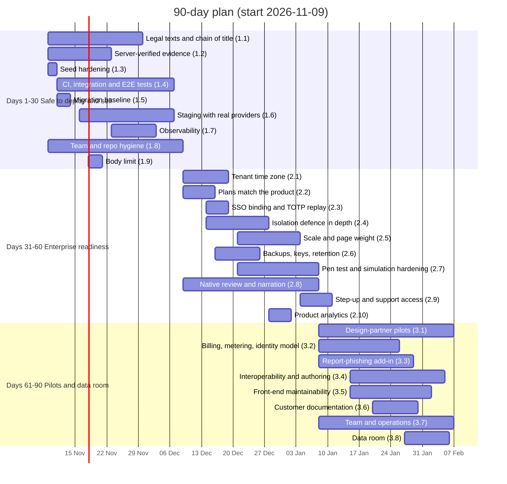

# Cyclowareness — 30 / 60 / 90-Day Roadmap to an Investor-Ready MVP

Companion to [`AUDIT.md`](AUDIT.md). Every work item names the audit findings it closes (L-, S-, Q-, D-, T-, M-, O- identifiers in the audit's section 7 register). Plan start is assumed to be **Monday 2026-11-09**.

## 0. Starting point and target

**Starting point.** The product is feature-rich and well engineered: a complete learner app, admin console, security-operations layer and operator console in ten languages, with a clean typecheck, lint, 2,697 passing unit tests and a passing production build. What is missing is **proof, process and paper**: it has never been deployed or run against real mail, SMS, identity or AI providers; there is no CI, no end-to-end testing, no observability or backups; training evidence can be forged from the browser; the legal texts name the wrong AI provider; and ownership of the content and mascot carried over from cylosof.com is undocumented.

**Definition of an investor-ready MVP (exit criteria for day 90):**

1. **Live pilots with evidence.** Two or three design-partner organisations (at least one regulated) use the platform in production for four weeks or more, and the platform's own reports show their baseline and current assigned-training completion, simulation click rate and report rate.
2. **Trustworthy evidence.** Lesson completion, answers, attestations and certificates are verified on the server; an external penetration test has been done and its High findings are closed.
3. **Repeatable delivery.** Every change passes CI (typecheck, lint, unit, integration on PostgreSQL, Playwright smoke, migration test, container build) and goes through staging before production; backups are tested; incidents are visible in monitoring before customers report them.
4. **Honest offer.** Plans, pricing page and settings screens promise only what is built; legal texts, DPA and sub-processor list are correct and reviewed by counsel in the launch languages.
5. **Clean paper.** Chain of title for content, mascot and brand is documented in a data room.
6. **No single point of failure.** A second senior engineer has shipped to production through the pipeline, and every merge has had a human reviewer.

**Capacity assumption.** The plan assumes the founder plus one senior full-stack engineer (contract from day 1, permanent hire by day 60), both using the AI-agent workflow that produced the codebase, but with human review on every merge. Effort is in engineer-weeks (ew). Each phase is about 11–13 ew, which this team can deliver in 30 days. With the founder alone, keep the order and stretch the plan to 120–150 days.

---

## 1. Days 1–30: safe to deploy, safe to sell

Goal: close both Critical findings and the High findings that block a first deployment; put the delivery pipeline in place.

| # | Work item | Closes | Effort | Owner |
|---|---|---|---|---|
| 1.1 | **Paper first.** Collect evidence of ownership for everything carried over from cylosof.com (lesson corpus, `mascot.riv`, design tokens, landing copy, legal texts): company records, IP assignments from any co-founders, employees or contractors who worked on it. Rewrite the privacy policy and terms in az and en with the real processors (Anthropic for tutor, subtitles and studio; ElevenLabs for narration; the browser's own speech engine), the provider's legal identity and contacts, retention that matches the code, a sub-processor list and a DPA template; counsel reviews. Add a proprietary `LICENSE`. | L-01, L-02 | 0.5 ew + counsel | Founder |
| 1.2 | **Server-verified training evidence.** Open a server-side attempt in `startLessonAction`; record scene progress on the server; score answers on the server from `lesson_contents` instead of trusting `correct`/`firstTry`/`outcome`; enforce a minimum dwell time; require every scene reached before XP, completion, attestation and certificate. Wrap attestation, module status and certificate in one transaction with unique keys per user and module. Mark evidence created before the fix as "self-reported" in compliance exports. Integration tests for the forged-completion and double-attest cases. | S-01, Q-03 (server part) | 2 ew | Engineer |
| 1.3 | **Seed hardening.** Random seed password printed once; no `super_admin` in the seed; refuse to run when `NODE_ENV=production` or when the database holds non-demo tenants; remove the published password from `.env.example` and the README; rotate the password of any demo or presentation instance that is reachable from outside. | S-04 | 0.25 ew | Founder |
| 1.4 | **CI and real tests.** GitHub Actions on every pull request and on `main`: `npm ci`, typecheck, ESLint, Vitest with a coverage report, `check-lesson-locales --coverage`, `next build`, `docker build`, all migrations applied to a PostgreSQL 16 service, nightly `npm audit`, Renovate for dependencies, `engines` and `.nvmrc`. New integration suite on real PostgreSQL (testcontainers): sign-in with 2FA and lockout, invite and reset links, SSO start and callback against a mock OIDC provider, campaign launch → outbox → tracked click → behaviour risk, lesson → attestation → certificate, one full `runJobs` tick. Playwright smoke suite for ten journeys (sign-in, Home, lesson player, attestation, people import, campaign wizard, settings save, report export, threat report → loop, operator creates a tenant) in az, en and ar. Validate lesson checkpoints and add `formatVersion` to the lesson schema so content errors fail CI instead of the server start. | T-01, T-02, T-03, Q-04, D-06, D-07 | 4 ew | Engineer |
| 1.5 | **Migration baseline.** Freeze `drizzle/0000_init.sql`; additive `000N` migrations only; replace the README's "regenerate from scratch" note; CI proves an upgrade from the previous release's schema. | D-01 | 0.5 ew | Engineer |
| 1.6 | **Staging with real providers.** One staging stack (managed PostgreSQL, container host, TLS proxy) exercised against: a real SMTP relay with SPF/DKIM/DMARC; one SMS gateway through a provider adapter (Twilio or a local operator); Microsoft Entra ID and Keycloak for OIDC; the Anthropic API for tutor, subtitles and studio. Fix what breaks and record a deployment runbook. | M-01 | 2 ew | Engineer |
| 1.7 | **Observability baseline.** Structured JSON logs with request, tenant and user ids; Sentry (or OpenTelemetry with a hosted backend); metrics for job-tick duration, outbox and webhook backlog, rate-limit refusals; a job-runner heartbeat in `/api/health`; alerts to the founder's phone. | O-03 | 1 ew | Engineer |
| 1.8 | **Team and repository hygiene.** Start hiring the second engineer (contract now, permanent by day 60); pull requests with mandatory human review on `main`; `SECURITY.md`, `CONTRIBUTING.md`, `CODEOWNERS`; remove founder-machine paths from `.claude/launch.json` and move the agent workflow scripts out of `docs/build`; English summaries of the 33 ADRs, the progress log and the open questions; remove the third-party agency logo and screenshots from the public repository. | O-01, O-02, O-06, D-08 | 0.5 ew + hiring | Founder |
| 1.9 | **Request size.** Lower the Server Action body limit to 1 MB and move the sandbox upload to a route handler with a streaming 10 MB cap. | S-05 | 0.5 ew | Engineer |

**Day-30 exit criteria:** CI green on `main` with integration and smoke tests; staging running with real mail and one real identity provider; forged lesson completion impossible; corrected legal texts published; chain-of-title evidence collected.

---

## 2. Days 31–60: enterprise readiness for paying design partners

Goal: remove what a bank's or agency's security questionnaire would flag, and make the offer match the software.

| # | Work item | Closes | Effort | Owner |
|---|---|---|---|---|
| 2.1 | **Tenant time zone.** IANA `timeZone` in tenant settings (default `Asia/Baku`), used by due dates, reminders, streak days, scheduled reports, CSV/XLSX times and the interface; daylight saving handled. Required before any customer in Saudi Arabia, Turkey or the EU. | D-02 | 1.5 ew | Engineer |
| 2.2 | **The offer matches the software.** Hide SAML, LDAP, voice and Android-only settings until they exist; voice campaigns refuse to launch without a real telephony adapter; update `PLAN_FEATURES`, the pricing page and sales material. Decide per pilot whether SAML (via a vetted library) or SCIM is worth building in days 61–90. | M-02 | 1 ew | Founder + engineer |
| 2.3 | **Identity hardening.** Bind SSO accounts to the provider's `iss` + `sub`; administrator approval when the email changes; accept only verified claims; store the last used TOTP step to prevent replay. | S-02, S-09 | 0.75 ew | Engineer |
| 2.4 | **Isolation in depth.** PostgreSQL row-level security on tenant tables with a per-transaction `app.tenant_id` (or, at minimum, a generated cross-tenant test that calls every action and route with another tenant's ids); rate-limit the import preview and stop disclosing other tenants' accounts; unique verified domain; validate `lessonKey`; restrict sign-off IPs to auditors. | S-03, S-08, S-11 | 2 ew | Engineer |
| 2.5 | **Scale and page weight.** Per-tenant jobs move from every minute to hourly/daily with a `job_runs` ledger; batch risk updates in one statement; whole-tenant recomputes and campaign launches move to the job queue; scope platform-wide lookups; send per-route message namespaces instead of the whole catalogue; lazy-load the mascot; move avatars out of the `users` row. Load test with k6 at 10 tenants × 5,000 learners. | D-03, D-04, D-10 | 2 ew | Engineer |
| 2.6 | **Backups, keys and retention.** Nightly dumps plus WAL archiving with a tested restore and written RPO/RTO; envelope encryption with key ids so `APP_SECRET` can rotate; domain-proof values from a separate stable key; per-tenant retention policies enforced by the clean-up job, including the promised 24-month deletion of demo requests. | O-04, S-07, L-03 | 1.5 ew | Engineer |
| 2.7 | **External penetration test and simulation hardening.** Commission a test of the multi-tenant app, SSO, phishing landing pages and operator console; close High findings by day 60. Count a simulation click only after a human interaction (JavaScript beacon or second request); register dedicated simulation sending domains and publish allow-listing guides for Microsoft 365 and Google Workspace; scope the tutor answer cache per tenant. Start a SOC 2 / ISO 27001 readiness gap list. | M-09, S-10 | 1.5 ew + vendor | Founder + engineer |
| 2.8 | **Languages and voice.** Native-speaker review of interface, module titles and a lesson sample for the next launch languages (recommended order tr, ar, ka) and resolution of the open terminology choices; generate ElevenLabs narration for az, en and ru after native voice selection (about USD 30 per language). | M-03, M-04 | 0.5 ew + reviewers | Founder |
| 2.9 | **Step-up and support access.** Password + TOTP re-entry for 2FA resets, reset links and role changes; notification to the target and other administrators; second-administrator approval for actions on peer administrators; replace the operator's reset link with a consented, time-boxed support-access grant. | S-06 | 1 ew | Engineer |
| 2.10 | **Product analytics.** Self-hosted, privacy-respecting analytics (PostHog or Plausible) for activation, weekly active learners, lesson drop-off and campaign funnels; an operator metrics page for pilot reporting. | M-08 | 0.5 ew | Engineer |

**Day-60 exit criteria:** a design partner can be onboarded without the founder's laptop; penetration-test High findings closed; nothing unbuilt is offered; tenants outside Azerbaijan see their own time; backups restored successfully at least once.

---

## 3. Days 61–90: pilots, commercial plumbing and the data room

Goal: turn the platform into a business an investor can diligence.

| # | Work item | Closes | Effort | Owner |
|---|---|---|---|---|
| 3.1 | **Design-partner pilots.** Two or three organisations live, ideally one regulated entity and one SME, with an onboarding checklist, a baseline simulation in week 1, weekly success reviews and a closing report produced from the platform. | Exit criterion 1 | Ongoing | Founder |
| 3.2 | **Billing and identity model.** Seat counting per tenant and invoice export for pilots; a payment provider for self-serve Essentials; a 14-day trial gated by domain proof. Separate global identities from tenant memberships so one person can belong to several organisations, which the partner/MSSP channel in the pricing model requires. | M-05, D-05 | 2.5 ew | Engineer |
| 3.3 | **"Report phishing" in the inbox.** An Outlook add-in MVP, or a per-tenant inbound address that files a threat report from a forwarded message and matches the simulation token automatically. Reporting drives 40 % of the league score and starts the SecOps loop. | M-06 | 3 ew | Engineer |
| 3.4 | **Interoperability and authoring.** SCIM 2.0 provisioning and a read-only reporting API; SCORM/xAPI export if a pilot needs it; a structured Studio editor for choice, swipe and hotspot scenes with translations and version history; server-side PDF for certificates and scheduled reports. | M-07, M-10, M-11 | 3 ew | Engineer |
| 3.5 | **Front-end maintainability.** One file per scene and per settings tab with a memoised scene context; component tests for every scene type; one action-result type with shared client error handling and segment-level error boundaries; campaign templates moved to content JSON; mascot engine converted to TypeScript with one source of truth; unused Rive assets removed; bundle-size budgets and Lighthouse checks in CI. | Q-01, Q-02, Q-03 (client part), Q-05, D-09 | 2.5 ew | Engineer |
| 3.6 | **Customer documentation.** Administrator guide, learner quick start, webhook and syslog integration guide, security whitepaper, SLA and support policy, status page. | O-05 | 1 ew | Founder + writer |
| 3.7 | **Team and operations.** Second engineer permanent and on call; QA and content-review contractor; incident-response plan and post-mortem template; quarterly access review. | O-01 | Hiring | Founder |
| 3.8 | **Data room.** This audit and roadmap with their closure status, architecture and security documentation, penetration-test letter, pilot metrics, chain-of-title evidence, trademark and domain status, refreshed pricing and unit-economics model using pilot data. | All | 0.5 ew | Founder |

**Day-90 exit criteria:** paying or committed pilot customers with measured outcomes; revenue plumbing in place; a second engineer shipping through the pipeline; a data room an investor can open.

---

## 4. Budget outside salaries (estimates, to be confirmed with vendors)

| Item | Estimate |
|---|---|
| Legal review of privacy policy, terms and DPA (az, en) | USD 3,000–8,000 |
| External penetration test (web app, SSO, operator console) | USD 8,000–15,000 |
| Native review, per additional language | USD 1,000–2,000 |
| Narration for az, en, ru (ElevenLabs, per the project's dry run) | about USD 100 |
| Staging and production hosting, monitoring, error tracking | USD 300–700 per month |
| Contract senior engineer for 90 days | market rate; the largest line |

---

## 5. Innovation bets worth protecting

The roadmap is deliberately about proof and process so that the differentiators already in the code can be sold. Do not cut these to make the plan fit; build on them once the foundations are in place.

- **Closed-loop human risk management.** A reported phish becomes an incident, which becomes targeted training with a pass mark, which closes a behaviour risk; the whole chain is audited (`portal/src/server/services/secops.ts`). Position the product as human risk management, not as compliance training.
- **"Lesson from last week's attack."** The AI trainer with its three-step verification (`portal/src/server/ai-verify.ts`) can turn a real incident from a pilot into a reviewed micro-lesson within hours. Few competitors can show this live.
- **Adaptive paths.** The explainable risk score with daily history per person (`portal/src/lib/domain/risk.ts`) can drive automatic assignment of the next module from each person's weakest category; once evidence is server-verified (1.2) this becomes a credible product claim.
- **Ten languages with right-to-left Arabic, per-sentence narration and AI subtitles in 65 more languages.** A real advantage for Gulf, Caucasus and multinational buyers once native review is done.
- **The storybook mascot.** Unusual in a compliance product and the most memorable moment in a demo. Keep it, and use the pilots to measure whether it improves completion.

## 6. Risks to this plan

| Risk | Mitigation |
|---|---|
| Founder bandwidth: product, engineering, sales, content and legal in one person | Contract the second engineer in week 1; the founder keeps product, sales and paper; engineering items move to the engineer. |
| Chain-of-title evidence is incomplete | Start 1.1 on day 1; if a gap appears, budget for an assignment agreement or re-authoring of the affected lessons and mascot before closing. |
| Design partners sign slowly | Start with the founder's network; offer a free pilot in exchange for a case study and outcome data; the product is already complete enough to demo. |
| Scope creep from the 25 open questions in `docs/build/OPEN-QUESTIONS.md` | Feature freeze until day 60 except roadmap items and pilot blockers. |
| On-premise demands from regulated buyers | The compose stack already supports it; add self-hosted fonts and an offline AI mode (the tutor already falls back to lesson text). |
| AI-translated content embarrasses the product in a new market | Launch az, en and ru first; add a language only after native and legal review (2.8). |
